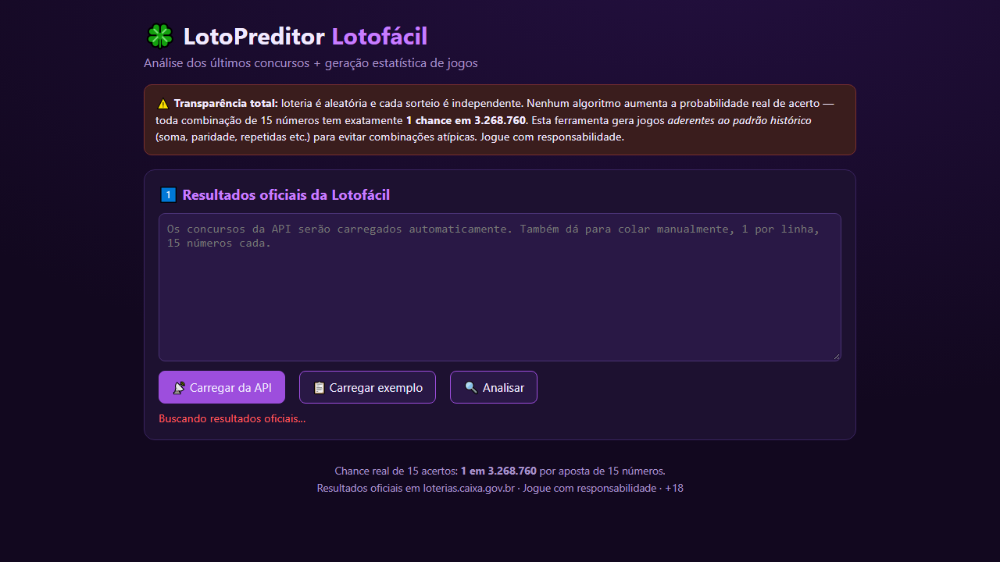

# LotoPreditor — Lotofácil

Aplicação web para análise de resultados oficiais da Lotofácil, visualização de frequência dos números e geração de jogos com base no histórico recente.

## Visão geral

O LotoPreditor foi desenvolvido como uma ferramenta de estudo e análise estatística para a Lotofácil. Ele permite:

- carregar resultados oficiais da API da Caixa;
- analisar frequência, atraso e padrões históricos;
- gerar combinações com diferentes estratégias;
- conferir os números do jogo com um resultado informado manualmente;
- manter uma interface simples e responsiva em HTML, CSS e JavaScript puro.

> Importante: a ferramenta não garante lucro nem aumenta a chance real de acerto. A loteria continua sendo um evento aleatório e independente.

## Captura de tela



## Funcionalidades

### 1. Carregamento de resultados oficiais
- consulta a API pública da Caixa;
- tenta carregamento direto e com fallback por proxy em caso de bloqueio de CORS;
- normaliza os dados recebidos para o formato de 15 dezenas;
- permite também a entrada manual de concursos.

### 2. Análise estatística
- frequência dos números;
- números mais e menos frequentes;
- atraso de cada número desde a última aparição;
- soma média, ímpares e comparação de padrões.

### 3. Geração de jogos
- estratégia genética;
- estratégia híbrida;
- frequência;
- atraso;
- coocorrência/Markov.

### 4. Validação de resultado
- o usuário informa os 15 números sorteados;
- a aplicação compara com os jogos gerados;
- exibe a quantidade de acertos por jogo.

## Estrutura do projeto

```text
Lotofacil/
├── README.md
├── lotofacil.html
├── styles.css
├── script.js
├── lotofacil.png
└── (opcional) arquivos temporários ou logs de teste
```

### Descrição dos arquivos

- `lotofacil.html`: estrutura principal da interface.
- `styles.css`: estilos visuais, tema escuro, cards, botões, bolas e layout.
- `script.js`: lógica da aplicação, carregamento da API, análise e geração de jogos.
- `lotofacil.png`: captura da interface para documentação.

## Requisitos

- navegador moderno;
- acesso à internet para carregar os resultados oficiais;
- ambiente local para servir os arquivos estáticos.

## Como executar

### Opção 1: abrir diretamente no navegador
Basta abrir o arquivo `lotofacil.html` em qualquer navegador moderno.

### Opção 2: rodar um servidor local
No diretório do projeto, execute:

```bash
python -m http.server 8000
```

Depois acesse:

```text
http://localhost:8000/
```

Ou, se preferir, use qualquer servidor estático do seu ambiente.

## Como usar

1. Abra a página no navegador.
2. Clique em "Carregar da API" para buscar os resultados oficiais.
3. Opcionalmente, clique em "Carregar exemplo" para testar o fluxo com dados já prontos.
4. Ajuste a estratégia de geração e quantidade de jogos.
5. Clique em "Gerar".
6. Use o campo de conferência para validar um resultado manualmente.

## Observações técnicas

### API da Caixa
A aplicação consulta a API da Lotofácil da Caixa para obter os resultados mais recentes. Em alguns ambientes, há bloqueio de CORS ou respostas em formatos distintos, por isso o código inclui lógica para:

- tentar acesso direto;
- tentar fallback usando proxy;
- normalizar estruturas alternativas retornadas pela API.

### Limitações
- a geração é baseada em padrões históricos e estatísticos, não em garantia de acerto;
- quanto menor a base histórica, menor a confiabilidade da análise;
- o projeto foi pensado como uma ferramenta educativa e demonstrativa.

## Aviso importante

A Lotofácil é um jogo de azar. A probabilidade de acerto de uma aposta simples de 15 números é:

- 1 em 3.268.760

O projeto apenas organiza padrões históricos para apoiar a análise, não para alterar as chances reais do sorteio.

## Licença

Este projeto foi desenvolvido para fins educacionais e de demonstração. O uso é livre para estudo e experimentação.

## Status

Projeto em funcionamento com interface estável, carregamento de API e análise estatística funcional.

## Contribuição

Contribuições são bem-vindas. Sugestões de melhorias incluem:

- melhor integração com fontes de dados;
- filtros de análise mais avançados;
- exportação de jogos;
- estruturação em módulos maiores para manutenção;
- testes automatizados para validação da lógica.
